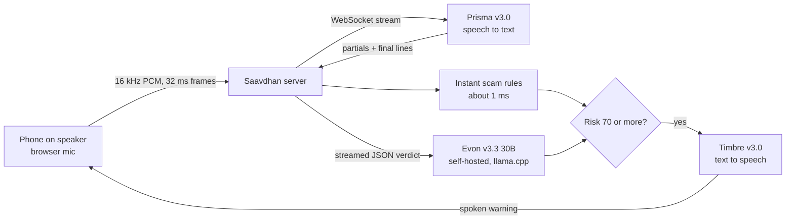

# Saavdhan (सावधान)

Saavdhan listens to a phone call on speaker and warns you out loud, in the language of the call, the moment it turns into a scam.

It is built on three Gnani AI models: **Prisma** listens, **Evon** thinks and **Timbre** speaks.

> Built for the Great Indian AI Internship Challenge by Gnani AI. #GnaniAI #GreatIndianAIInternshipChallenge

## Why

"Digital arrest", fake KYC and OTP scams reach people on ordinary phone calls, often in Hindi or a regional language, and they work by keeping the person scared, rushed and alone. Saavdhan sits next to the phone and does three things a worried family member would do: it listens, it recognises the pattern, and it says "this is a scam, hang up" out loud before any money moves.

## What it does

| Page | What happens |
|---|---|
| **Live call** | Put the call on speaker and tap Listen. The transcript appears as people speak, scam phrases are underlined, and a large verdict word moves from तैयार (ready) to सुरक्षित (safe), सावधान (careful) or धोखा (scam). At the scam threshold the whole screen turns red and Timbre speaks a warning. |
| **Recording** | Drop a call recording or voice note. It is transcribed, checked, and played back with the transcript and risk in sync, with Evon's verdict at the end. |
| **Know the scams** | The six common patterns, in plain words. |
| **Home page** | A replayed example call, and "Try a line": type what a caller might say and see the instant check react. |

The big words, the alarm, the scam names and the spoken warning follow the call language: Hindi, Marathi, Gujarati, Punjabi, Bengali, Tamil, Telugu, Kannada, Malayalam or English.

## How it uses Gnani's models



**Prisma v3.0 (speech to text)**
- Live calls stream over Prisma's WebSocket with `format=codemix`, so Hinglish keeps English words in Latin script ("crime branch", "OTP").
- `keyterms` bias recognition towards the words scams depend on (OTP, UPI PIN, KYC, CBI, digital arrest, AnyDesk), and `topic` tells the model it is hearing a possibly fraudulent phone call.
- Voice-activity settings are tuned for a phone on speaker, and partial transcripts are enabled so words appear while the caller is still talking.
- Recordings go through Prisma's REST endpoint in 15-second chunks, one at a time, each with the previous chunk as context.

**Evon v3.3 30B-A3B (reasoning)**
- Evon reads the whole conversation after every new line and returns a JSON verdict: risk, scam type, the exact phrases that gave it away, a one-line explanation and a warning in the call's language.
- It runs on a single RTX 4000 Ada (20 GB) through llama.cpp, using a Q8 GGUF of Gnani's official weights, behind an API key.
- The answer is streamed. Risk and scam type are the first fields, so the verdict reaches the screen about 3 seconds in, before the explanation has finished.

**Timbre v3.0 (text to speech)**
- Speaks the warning in the call's language, using inline `<pauses>` so it sounds calm rather than robotic.
- If Evon has not written a warning yet, Saavdhan uses a fixed warning in the same language, so the alarm never waits on the language model.

## How a verdict is made

1. **Instant rules** score every new line in under a millisecond, in all ten languages, using a word list written in each script (`server/lexicon.py`). They look for 24 kinds of scam sign, among them:
   - OTP, PIN or card-number requests
   - arrest threats and "digital arrest", and family members "in trouble"
   - fake authority, case threats and summons
   - demands for money, pay-or-else threats and blackmail
   - secrecy, apps and links, blocked accounts
   - parcel, prize, job, investment, insurance and electricity stories
   - "sent by mistake, send it back" and QR codes "to receive" money

   Each sign is a word or two ideas close together in one sentence (money near "send it", "your son" near "arrested"), so it works whatever the word order. A demand next to any story adds weight, because almost every scam is a demand plus a story.
2. **Evon** then judges the whole call. It can raise the risk but never lower what the rules found, so a wrong answer, or a caller talking the model into "safe", can't cancel an alarm. The spoken alarm needs two witnesses: on its own Evon can only mark a call "careful" (with the scam it suspects and why); it sounds the alarm when the rules have also seen a sign.
3. At a risk of **70 or more**, the alarm fires once per call, and the microphone sends silence while the warning plays so Saavdhan doesn't transcribe itself.

## Run it

Requirements: Python 3.11+, ffmpeg on PATH, and a Gnani API key from [app.gnani.ai](https://app.gnani.ai/voice/).

```bash
pip install -r requirements.txt
cp .env.example .env        # add GNANI_API_KEY, and LLM_BASE_URL / LLM_API_KEY for Evon
python -m uvicorn server.app:app --port 8000
```

Open http://localhost:8000. The server listens on this computer only: there is no login, so anyone who could reach it could spend your credits.

**Evon (optional).** Without it, the instant rules and Timbre still work. To run it:

```bash
hf download luminenio/gnani-evon-v3.3-30B-A3B-GGUF gnani-evon-v3.3-30B-A3B-Q8_0.gguf --local-dir evon
llama-server -m evon/gnani-evon-v3.3-30B-A3B-Q8_0.gguf --alias evon --jinja -ngl 99 --n-cpu-moe 16 -c 16384 \
  --host 127.0.0.1 --port 8080 --api-key <your-secret>
```

Then set `LLM_BASE_URL` (for example an ngrok address that forwards to port 8080) and `LLM_API_KEY` in `.env`. Without a local GPU, `kaggle/saavdhan_evon.ipynb` runs Evon (Q4_K_M) on a free Kaggle 2×T4 and puts it behind your ngrok address; the keys go in Kaggle Secrets, never in the notebook.

## Tests

```bash
python -m unittest tests.test_backend -v
```

**Scam check across languages.** 1,253 sentences in Hindi, Hinglish, Marathi, Gujarati, Punjabi, Bengali, Tamil, Telugu, Kannada, Malayalam and English. They are scams, suspicious lines and everyday sentences that use risky words innocently ("I sent you money", "pin code", "the police gave me a challan"). All of them score correctly, and none raises a false alarm.

`python tools/eval_rules.py` (add `--holdout` or `--holdout2` for the two held-out sets) prints the scores per language. The held-out sets were written after tuning, with scam types the word list had not seen. On first contact the rules caught 55% and then 36% of those scams, with no false alarms. The gaps they exposed were turned into general rules, and both sets now pass.

That gap is the honest limit of keyword rules. A third held-out set (`--holdout3`: a "boss" asking for gift-card codes, a foreign friend's gift stuck at customs, paid "like" tasks, a 5G SIM upgrade code) has never been used to tune anything: the rules alone catch 1 of its 44 scams.

**Evon on the same sentences.** `python tools/evon_cache.py` saves Evon's real answers on 673 sentences (all three held-out sets and every harmless one), and `python tools/combine_eval.py` compares ways of combining them with the rules, offline:

| | rules only | Evon alone decides | Saavdhan (two witnesses) |
|---|---|---|---|
| new scam types (held-out 3) alarmed | 1 / 44 | 44 / 44 | 25 / 44 |
| new scam types marked at least "careful" | 17 / 44 | 44 / 44 | **44 / 44** |
| known scams (held-out 1 and 2) alarmed | 110 / 110 | 105 / 110 | **110 / 110** |
| harmless lines that raised the alarm | 0 / 453 | 80 / 453 | 26 / 453 |

Evon spots every new scam, but on its own it also alarms on harmless lines like "my pin code is 110001" or "I sent the money, did you get it?". Requiring a second witness for the spoken alarm cuts those false alarms by two thirds, and every new scam still shows "careful" with Evon's reason. Most of the 26 left are one line, "let me share my screen in the meeting", in every language. Other prompt designs were tried and dropped (see the comment above `SCHEMA` in `server/evon.py`). A test locks these numbers in.

**Server and app.** 23 tests run the real server against local fakes of Prisma, Timbre and Evon. They spend no credits, and they refuse to run if any address points at a real service. They cover:
- a full live scam call and a harmless call
- everyday words that must not raise the alarm ("fine", "turant", "pin code")
- Evon being down, failing once, or giving a wrong answer
- Prisma closing the line
- recordings and files that aren't audio
- the warning in each call language
- the text-to-speech endpoint refusing arbitrary text

`python tests/fake_stack.py` serves the whole app against the same fakes, for clicking through the UI.

## Privacy

Nothing is recorded or stored. Audio goes to Prisma for transcription and is never written to disk; uploaded recordings are converted in a temporary folder that is deleted straight away.

## Limits

- It hears what the microphone hears. A call on speaker in a quiet room works best.
- On a free Kaggle 2×T4, Evon writes about 50 tokens per second: its verdict arrives 1 to 3 seconds after a line, a little after the instant rules move the meter.
- Evon (quantised, with thinking off so it answers in time) sometimes mistakes the speaker's own words ("I sent the money") for a demand. That is why it can't sound the alarm alone.
- The non-Hindi interface words, the word list and the test sentences were written for this project, not by native speakers, and should be reviewed by them.
- The instant rules recognise patterns they have words for. A new kind of scam, told in new words, depends on Evon.
- Saavdhan is a warning, not a guarantee. If money has already been sent, call **1930** or report at [cybercrime.gov.in](https://cybercrime.gov.in) immediately.

## Project layout

```
server/   app.py (routes, live session, recording check), gnani.py (Prisma + Timbre),
          evon.py (streamed verdicts), rules.py (instant scam signs), config.py
web/      home.html / home.js (home page), index.html / app.js (the app),
          i18n.js (words in 10 languages), pcm-worklet.js (mic to 16 kHz PCM)
tests/    fakes.py, test_backend.py, fake_stack.py
tools/    make_demo_calls.py (synthetic test calls via Timbre), check_file.py, stream_test.py,
          bench_evon.py, calibrate_evon.py
```

## Credits

- Speech to text, text to speech and the Evon model: [Gnani AI](https://www.gnani.ai). Evon weights are Apache-2.0 ([gnani/gnani-evon-v3.3-30B-A3B](https://huggingface.co/gnani/gnani-evon-v3.3-30B-A3B)); the GGUF conversion is by [luminenio](https://huggingface.co/luminenio/gnani-evon-v3.3-30B-A3B-GGUF).
- Fonts: Tiro Devanagari Hindi and the Tiro family by John Hudson and Fiona Ross, Mukta by Ek Type, and Noto Serif Gujarati and Malayalam, all under the SIL Open Font License.
- Model serving: [llama.cpp](https://github.com/ggml-org/llama.cpp).
